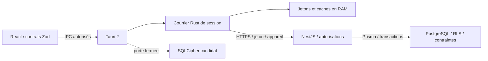

# CaissePro — audit préalable de l’étape 11

**Date : 11 novembre 2026, Africa/Kinshasa.**

**Référence auditée : `a347622b28952db2408cad3f0d30a06af2a94930`.** Branche créée : `audit/etape-11-devises-bcc-preferences`.

Cette étape produit une analyse et une proposition. Aucun service métier, schéma Prisma, migration historique, montant, solde, document comptabilisé ou paramètre de base n’est modifié. Aucun installateur n’est créé. L’étape 10 demeure à exécuter ; la connexion locale macOS confirmée par l’utilisateur ne vaut pas qualification complète Windows/macOS.

## 1. Résultat de l’audit

L’architecture existante peut accueillir les trois évolutions, en conservant le serveur comme autorité financière et le courtier natif comme frontière de session. **Une modification du seul sélecteur de devise serait insuffisante et incompatible avec les protections actuelles.**

Les principaux constats sont :

1. Le système financier est volontairement limité à CDF/USD, dans plusieurs couches indépendantes : enum PostgreSQL/Prisma, contrats Zod, unions TypeScript, formulaires, code Rust et SQLite candidat. Les rapports et clôtures imposent aussi exactement deux devises, parfois sans écrire leur nom.
2. Les montants sont exacts, mais le format de bout en bout est fixé à deux décimales. Ajouter des codes et accepter des devises à zéro ou trois décimales sont deux changements distincts.
3. Deux familles de taux existent : les références publiées par l’administration et les taux effectivement attachés aux conversions. Les premières ne disposent pas d’une liaison structurée avec une publication officielle BCC ; leur sélection est actuellement recopiée dans le transfert.
4. Aucun connecteur BCC ni ordonnanceur d’import serveur n’a été identifié. Aucun contrat d’API BCC, endpoint, format de réponse ou calendrier de publication n’est affirmé vérifié.
5. Le thème clair/sombre/système existe. La clé `caissepro.appearance` est commune à la WebView et ne comporte aucune identité utilisateur. Aucune préférence visuelle personnelle n’existe en base. La fenêtre Tauri est configurée en mode incognito : la persistance de ce stockage entre redémarrages n’est pas garantie par cet audit.
6. Les mécanismes financiers existants sont à préserver : montants en chaînes, Decimal/SQL numeric, équilibres par devise, réservations, permissions serveur, RLS, sessions, confirmations distinctes et immutabilité.

**Conclusion de cadrage :** commencer par les sauvegardes et la compatibilité, puis les préférences indépendantes du financier et les structures additives. L’activation d’une troisième devise attend une migration cohérente de toutes les couches. Les cours BCC restent des références jusqu’à validation explicite d’une opération.

## 2. Périmètre, preuves et limites

L’inventaire parcourt **223 fichiers texte suivis au commit de référence**, hors fichiers binaires et quatre verrouillages de dépendances. Il repère **457 lignes contenant CDF/USD, dans 69 fichiers**, noms de champs compris, sans distinction de casse. Ces lignes comprennent du code, des tests, de la démonstration et de la documentation : elles ne sont pas toutes des restrictions exécutables. L’analyse des cardinalités et précisions complète cette recherche lexicale.

| Annexe                                                   | Contenu                                                                                                                                                  |
| -------------------------------------------------------- | -------------------------------------------------------------------------------------------------------------------------------------------------------- |
| [occurrences-cdf-usd.tsv](occurrences-cdf-usd.tsv)       | Chaque ligne concernée, avec catégorie, fichier, numéro et extrait ; couverture du commit figé                                                           |
| [precision-et-calculs.tsv](precision-et-calculs.tsv)     | 149 lignes candidates : Decimal, formats, arrondis, cardinalités, validations natives et conversions numériques ; à interpréter selon leur usage         |
| [champs-prisma.tsv](champs-prisma.tsv)                   | Champs devise, Decimal et JSON des modèles ; les JSON demandent aussi l’analyse de leurs producteurs et lecteurs                                         |
| [objets-sql-historiques.tsv](objets-sql-historiques.tsv) | 195 déclarations nommées retrouvées dans l’historique, avec leurs remplacements successifs ; ce n’est pas un catalogue des objets effectivement déployés |
| [migrations.sha256](migrations.sha256)                   | Empreinte de chacune des 15 migrations historiques                                                                                                       |
| [inventaire.json](inventaire.json)                       | Synthèse chiffrée et liste des 39 modèles Prisma                                                                                                         |
| [inventaire.py](inventaire.py)                           | Générateur reproductible, lisant exclusivement les fichiers Git du commit indiqué                                                                        |

Pour régénérer : `python3 docs/audit-etape-11/inventaire.py`. Le générateur n’ouvre pas `.env`, ne se connecte pas à PostgreSQL et ne suit pas les fichiers privés du poste utilisateur. Les verrouillages pnpm/Cargo sont examinés comme mécanismes de reproductibilité, et exclus de la recherche textuelle des devises pour éviter leurs empreintes hexadécimales sans signification monétaire.

Les chemins d’exécution financiers et les protections SQL ont été examinés, avec inventaires transversaux. Cet audit structurel n’est ni un pentest, ni une certification de conformité comptable, ni une mesure de charge. La base du Mac, ses migrations réellement appliquées et les résultats de GitHub Actions n’ont pas été interrogés. La disponibilité réelle de la BCC n’a pas été testée.

### Vérifications exécutées pendant cet audit

| Vérification                                           | Résultat et portée                                                                                                                                                                      |
| ------------------------------------------------------ | --------------------------------------------------------------------------------------------------------------------------------------------------------------------------------------- |
| `pnpm check`                                           | Réussi : ESLint, TypeScript, tests existants et builds shared/API/frontend                                                                                                              |
| Tests de cette commande                                | **142 tests réussis** : 21 contrôles Node des permissions/lanceurs, 25 contrats partagés, 4 tests HTTP de disponibilité avec double, 92 tests React/contrôleurs avec passerelle simulée |
| Build Vite                                             | Réussi ; avertissements sur annotations de dépendance Zod et chunk JavaScript de 511,24 kB minifié, sans échec de compilation                                                           |
| `pnpm test:session` et `pnpm test:local`               | Tentés, sans exécution des tests Rust : `cargo` introuvable dans le PATH, confirmé par `spawnSync`, code `ENOENT`                                                                       |
| PostgreSQL réel, Rust/API, navigateur et desktop natif | Non rejoués pendant cet audit ; les résultats historiques de [validation.md](../validation.md) restent historiques                                                                      |
| Nouvelle fonctionnalité multidevise/BCC/préférences    | Non implémentée, donc aucun résultat de fonctionnement revendiqué                                                                                                                       |

Les scripts Rust ne rendent actuellement pas visible la cause d’un échec de lancement de Cargo. C’est un point de diagnostic à améliorer ultérieurement. Aucun contournement du verrou de qualification SQLCipher n’a été appliqué.

### Catalogue des tests existants

| Emplacement / commande                                       | Couverture identifiée                                                                                                                                                                                        |
| ------------------------------------------------------------ | ------------------------------------------------------------------------------------------------------------------------------------------------------------------------------------------------------------ |
| `packages/shared/src/*.test.ts`                              | Validation des contrats monétaires, reçus, dépenses, transferts, synchronisation, rapports et administration                                                                                                 |
| `apps/api/test/health.spec.ts`                               | Contrat HTTP de disponibilité, avec base simulée                                                                                                                                                             |
| `apps/api/test/integration/*.spec.ts`, `pnpm test:db`        | Neuf suites PostgreSQL : authentification, configurations de caisses, encaissements, dépenses, intégrité, administration, rapports, synchronisation et transferts ; le script crée sa propre base temporaire |
| `apps/desktop/src/**/*.test.ts(x)`                           | Neuf suites de vues, contrôleurs et transports simulés ; 92 tests rejoués                                                                                                                                    |
| `tests/e2e/*.spec.ts`, `pnpm test:e2e`                       | Cinq fichiers Playwright pour accueil, reçus, dépenses, transferts et rapports ; les scénarios avec IPC simulé ne valident pas à eux seuls le natif                                                          |
| `tests/native/*.test.mjs`                                    | Permissions IPC et outils de démonstration ; 21 tests Node rejoués                                                                                                                                           |
| `packages/session-core/src/tests.rs`, `transport_tests.rs`   | Sessions, autorisations, expiration, changements de génération et transport HTTP contrôlé                                                                                                                    |
| `packages/local-store/src/tests.rs`                          | SQLCipher et vérifications de stockage ; distinct de l’activation de la porte publique                                                                                                                       |
| `scripts/test-auth-desktop.mjs`, exemple Rust `api_contract` | Parcours courtier Rust → API réelle → PostgreSQL sur base de test, avec compte SQL restreint                                                                                                                 |
| `tests/smoke/api.test.mjs`, `pnpm test:api:live`             | API compilée et PostgreSQL réels ; nécessite un environnement préparé                                                                                                                                        |
| `tests/native/smoke-linux.sh`, `pnpm test:native:linux`      | Ouverture/rendu d’une fenêtre Linux ; pas une preuve Windows/macOS                                                                                                                                           |
| `.github/workflows/local-store-native.yml`                   | Matrice Windows/macOS, outils, SQLCipher, session et compilation Tauri debug sans bundle ; existence du workflow distincte d’un résultat réussi                                                              |

Ces commandes sont inventoriées, pas toutes exécutées. Les tests PostgreSQL/contrats natifs et les exercices de restauration restent à rejouer sur des données de test avant une migration future, sans jamais les pointer vers les données financières du poste utilisateur.

## 3. Architecture existante

### 3.1 Dossiers et dépendances

| Frontière                               | Responsabilité et dépendances déclarées                                                                                     |
| --------------------------------------- | --------------------------------------------------------------------------------------------------------------------------- |
| `apps/api`                              | NestJS 11.2.8, Prisma/adapter-pg/client 7.10.1, PostgreSQL, Zod 4.6.7, PDFKit 0.17.2, ExcelJS 4.4.0                         |
| `apps/desktop`                          | React 19.3.1, TypeScript 5.9.3, Vite 7.3.7, Tailwind 4.3.4 ; interface française                                            |
| `apps/desktop/src-tauri`                | Tauri Rust 2.12.5, CLI/API JS 2.12.4, tauri-build 2.7.4, dialogues natifs via rfd, commandes IPC limitées                   |
| `packages/shared`                       | Contrats Zod et types partagés : identité, montants, reçus, dépenses, transferts, synchronisation, rapports, administration |
| `packages/session-core`                 | Courtier Rust 0.3.0, reqwest 0.12 avec rustls et racines natives, serde, tokio, scrypt, zeroize                             |
| `packages/local-store`                  | Adaptateur Rust 0.2.0, rusqlite/SQLCipher/OpenSSL embarqués, keyring Windows/macOS ; porte publique fermée                  |
| `scripts`, `tests`, `.github/workflows` | Démonstration, contrôles, sauvegardes de sources, tests unitaires/intégration/IPC/natifs et workflow de qualification       |

Node requis : branche 24, minimum 24.11 ; pnpm 11.25.0 ; Rust 1.90.0. Les verrouillages pnpm/Cargo doivent rester versionnés. Aucune analyse CVE exhaustive n’est revendiquée ici.

Le frontend ne reçoit pas l’URL PostgreSQL. Le navigateur seul ne fournit pas une connexion financière fonctionnelle. Le transport authentifié du desktop appartient au courtier natif.

### 3.2 Services backend et routes

`AppModule` importe `DataModule` et `AuthModule`. Les services métiers sont actuellement enregistrés dans ces modules, dont plusieurs dans `AuthModule` ; l’ajout de modules dédiés réduira ce couplage sans déplacer immédiatement les services existants.

| Services existants                                                         | Fonction                                                                                 |
| -------------------------------------------------------------------------- | ---------------------------------------------------------------------------------------- |
| `PrismaService`, `HealthController`                                        | Connexion et disponibilité du schéma sous rôle restreint                                 |
| `AuthStore`, `PasswordService`, `AuthService`, `AdminService`, `AuthGuard` | Authentification, sessions, rôles, périmètres et administration des utilisateurs         |
| `CentralAccess`, `CatalogService`                                          | Transactions et accès au référentiel autorisé                                            |
| `LedgerService`                                                            | Écritures, encaissement, paiement, transfert, conversion, contre-écriture et idempotence |
| `DraftInboxService`, `SynchronizationService`                              | Réception, versionnement, déduplication et conflits des brouillons                       |
| `CashService`                                                              | Configuration des caisses, sessions et reçus                                             |
| `ExpensesService`                                                          | Plafonds, soumission, approbation/rejet, réservations, paiement et bons                  |
| `TransfersService`                                                         | Brouillon, remise, réception distincte, conversion et bordereau                          |
| `ReportsService`, `report-export`                                          | Indicateurs, journaux, clôtures et PDF/Excel                                             |
| `ManagementService`, `audit-export`                                        | Entreprise, agences, catégories, taux de référence, supervision et audit                 |

Routes regroupées sous `/api/v1` : `auth`, `admin`, `workspace`, `cash`, `expenses`, `transfers`, `reports`, `management`, `health`. Le contexte vient de `req.principal`, avec revalidation dans les transactions sensibles.

### 3.3 Frontend et natif

`App.tsx` gère le shell, la connexion, le verrouillage et les vues administratives de base. Les dossiers `cash`, `expenses`, `transfers`, `reports`, `management` contiennent les écrans spécialisés. `hybrid` porte les coordinateurs et buffers ; `auth/gateway.ts` constitue la frontière React/IPC. `ui/Appearance.tsx`, `ConfirmDialog.tsx` et `use-references.ts` portent l’apparence, les confirmations et les références.

Tauri expose une liste fermée dans `src-tauri/src/lib.rs`, `build.rs` et `capabilities/main.json`, vérifiée par `tests/native/permissions.test.mjs`. Les exports passent par un dialogue natif et une nouvelle vérification de génération/session avant écriture. Ajouter une route arbitraire ou un plugin générique shell/SQL/fichiers n’est pas nécessaire aux trois évolutions.

### 3.4 Prisma, migrations et protections

Le schéma décrit **39 modèles**. Le référentiel comprend entreprise, agences, caisses et comptes ; l’identité comprend utilisateurs, appartenances, rôles, permissions et sessions. Le financier comprend opérations, écritures, reçus, dépenses, approbations, réservations, transferts, taux, justificatifs et clôtures. `AuditEvent`, `AuthEvent` et `SyncEvent` ont des responsabilités distinctes. `FinancialCategory` et `ReferenceExchangeRate` portent les références administratives.

Les **15 migrations** vont de `20261104000100_central` à `20261109000200_management`. Elles contiennent des mécanismes absents d’une lecture Prisma seule :

- enum PostgreSQL, clés composites entreprise/compte/devise/agence, CHECK et index d’unicité ;
- RLS et FORCE RLS, rôles techniques et privilèges explicites ;
- vues `AccountBalance` et `AvailableFunds` avec `security_invoker` ;
- fonctions de permission et de session, verrouillage ordonné des comptes et contraintes différées au commit ;
- déclencheurs d’immutabilité des opérations, écritures, taux, justificatifs, décisions et instantanés ;
- vérification des réservations, des conversions et de l’identité des intervenants.

Les fonctions redéfinies doivent être lues chronologiquement. Par exemple, la dernière vue `AvailableFunds` inclut la réservation des transferts remis, ajoutée par la migration du 7 novembre. Le dernier garde d’audit, daté du 9 novembre, impose une liste fermée d’actions et de cibles. Une nouvelle action métier exige une **nouvelle migration** et des tests de privilèges.

### 3.5 Authentification, hors connexion et synchronisation

Les mots de passe sont dérivés avec scrypt. Le serveur crée un jeton aléatoire, en stocke une empreinte SHA-256 et applique limitations de tentatives, versions de sécurité, révocation, verrouillage et expirations. `AuthGuard` contrôle aussi `X-CaissePro-Device`. `CentralAccess` utilise SERIALIZABLE, SET LOCAL ROLE, un contexte transactionnel et une revalidation SQL de la session ; les reprises de conflits sont bornées.

Le natif garde jetons, brouillons, caches et buffers en mémoire, avec génération de session, périmètre et durée autorisée. Un changement d’utilisateur ou une réponse tardive ne doit pas réintroduire l’ancien contexte. Hors connexion : brouillons et consultations antérieurement autorisées, datées et bornées ; aucune approbation, remise, réception, clôture définitive ou modification de solde officiel.

La synchronisation envoie des brouillons identifiés par UUID stable, révision et dernière version serveur connue. Elle déduplique, signale les conflits et ne rejoue pas de confirmation financière. Les rapports natifs nécessitent actuellement une session en ligne revalidée. Les coordonnées de taux et les futures préférences devront suivre ces frontières sans créer de pouvoir comptable local.

`PLATFORM_STORAGE_VALIDATED` vaut **false** dans `packages/local-store/src/lib.rs`. La persistance financière chiffrée n’est pas activée ; aucun nouveau cache sensible ne doit s’appuyer sur elle avant qualification. Les futurs choix visuels peuvent être appliqués en RAM après lecture serveur ; l’identité utilisateur ne doit pas être introduite dans un stockage navigateur sensible pour contourner cette limite.

## 4. Gestion monétaire et dépendances CDF/USD

### 4.1 Restrictions exécutables et affichages

L’annexe donne tous les fichiers/lignes contenant explicitement les codes. Les principaux points à modifier ultérieurement sont :

| Endroit                                                             | Restriction ou usage actuel                                                                      |
| ------------------------------------------------------------------- | ------------------------------------------------------------------------------------------------ |
| `packages/shared/src/money.ts:2`                                    | Enum Zod CDF/USD, propagé aux contrats                                                           |
| `apps/api/prisma/schema.prisma:11` et première migration            | Enum de base utilisé par les comptes, lignes, documents, réservations, taux et transferts        |
| `apps/api/src/cash/cash.service.ts:170`                             | Création automatique des comptes pour les deux devises                                           |
| `apps/api/src/reports/reports.service.ts:196,330,347,389–417`       | Boucles de totaux, attentes et écarts ; clôture avec `countedUSD`/`countedCDF`                   |
| `apps/api/src/transfers/transfers.service.ts:75,274`                | Types locaux des comptes et contreparties limités aux deux codes                                 |
| `apps/desktop/src/auth/gateway.ts`                                  | Unions dans les DTO et appels des plafonds                                                       |
| Formulaires de reçus, dépenses, plafonds et transferts              | Sélecteurs, restaurations de brouillons, filtres et devises initiales codés explicitement        |
| `apps/desktop/src/reports/ReportsPage.tsx`                          | Deux courbes, couleurs dépendant d’USD, deux saisies de comptage et filtres fixes                |
| `apps/desktop/src/management/SettingsPage.tsx:673–678`              | Devise source USD initiale et destination définie comme « l’autre devise »                       |
| `packages/session-core/src/state.rs:256`, `broker.rs:269`           | Validation native des brouillons et des routes de politique par devise                           |
| `packages/local-store/src/lib.rs:225`, `migrations/001_local.sql:2` | Validation Rust et CHECK SQLite du stockage candidat                                             |
| `scripts/bootstrap-admin.mjs`, `scripts/demo.mjs`                   | Provisionnement des deux devises et fonds de démonstration ; à distinguer des mouvements réels   |
| `App.tsx:299–300` et textes d’interface                             | Mentions décoratives CDF/USD ; ce sont aussi des adaptations d’affichage, sans pouvoir financier |

**Restrictions sans littéral CDF/USD :** `reports.ts` impose `.length(2)` aux totaux, écarts et comptages, et au plus 732 points journaliers ; `closeCashSchema` impose les deux champs de comptage. `caissepro_closure_guard` exige `jsonb_array_length(counts) = 2`. Elles doivent être traitées même si une recherche des deux noms de devises ne les trouve pas.

Une conversion individuelle doit toujours porter sur **deux** devises et produire **quatre** écritures équilibrées par devise. Cette règle SQL ne doit pas être supprimée parce que le catalogue global comporte davantage de devises. Les contraintes « deux devises pour un FX » et « exactement deux devises dans toute clôture » n’ont pas la même portée.

### 4.2 Précision, arrondis et soldes

| Couche                | Constat                                                                                                                                            |
| --------------------- | -------------------------------------------------------------------------------------------------------------------------------------------------- |
| PostgreSQL/Prisma     | Montants `numeric(18,2)` ; taux `numeric(24,12)` ; montants positifs et relations composites contrôlés                                             |
| Contrats              | Chaînes décimales avec exactement deux chiffres après le point ; jusqu’à 16 chiffres entiers pour un montant                                       |
| Calculs API           | Clones Decimal à 60 chiffres pour les conversions ; produit exact avant arrondi final HALF_UP à deux décimales                                     |
| SQL                   | Recalcul de `round(sourceAmount * rate, 2)` dans les gardes ; PostgreSQL numeric positif correspond à l’arrondi HALF_UP utilisé ici                |
| Natif/SQLite candidat | Montants conservés comme chaînes ; validateurs imposant aussi deux décimales                                                                       |
| Courbes               | Calculs en BigInt centimes, division par 100 ; conversion en Number uniquement du ratio borné destiné aux coordonnées SVG, pas d’un solde officiel |
| Présentation          | `formatMoney` groupe les chiffres sans float ; plusieurs `.toFixed(2)` et valeurs `0.00` fixent néanmoins l’échelle                                |

`AccountBalance` somme les écritures par compte et devise. `AvailableFunds` retranche les réservations de dépenses et celles des transferts remis. Les comptes sont verrouillés et les invariants contrôlés au commit. Aucun champ de solde mutable ne doit apparaître dans la refonte.

**Point de décision :** un catalogue extensible peut d’abord activer des devises compatibles avec l’échelle actuelle, après généralisation des contrats. Une devise à trois décimales ne peut pas être annoncée opérationnelle tant que le stockage, les validations, l’arrondi, les documents et les échanges natifs restent à deux décimales. Une devise à zéro décimale exige aussi une politique d’acceptation et de présentation explicite.

La définition de devise doit figer sa politique une fois utilisée, ou référencer une version immuable. Les anciennes écritures et instantanés gardent leur représentation et leur arrondi historiques. Une extension de type numeric requiert une étude DDL spécifique : bornes, éventuelle réécriture physique, verrous, dépendances de vues/fonctions et conservation des valeurs existantes. Aucun changement de ce type n’est exécuté ici.

Les buffers natifs ont aussi des bornes lexicales dans `packages/session-core/src/synchronization.rs:187–191` : 19 caractères pour le montant, 25 pour le taux et 3 pour un code devise. Ces bornes doivent rester cohérentes avec les formats autorisés. Trois caractères conviennent à l’option ISO 4217 proposée ; la longueur du montant ne doit pas être oubliée lors d’une future extension d’échelle.

### 4.3 Conversion et provenance des taux

`TransferOrder` conserve source, destination, montant d’origine, montant cible, taux et source textuelle. Le montant cible est calculé à la préparation. La remise réserve ; une personne distincte réceptionne. L’opération et le bordereau sont alors créés atomiquement. Pour le FX, `ExchangeRate` fige le taux, sa paire, sa date et sa source ; l’opération s’y rattache.

`ReferenceExchangeRate` contient les références administratives immuables et datées. Le sélecteur de transfert recopie les valeurs choisies, mais `TransferOrder` ne stocke pas d’identifiant de référence officielle, et `ExchangeRate` n’a pas de lien structuré vers cette référence. Une simple chaîne `source = BCC` ne prouverait donc pas une origine officielle.

L’API limite actuellement la liste de références aux 50 plus récentes, toutes paires confondues. Avec davantage de devises, il faudra une sélection/pagination par paire et date, et une politique de fraîcheur ; le taux récent d’une paire ne doit pas faire disparaître toutes les autres paires du choix.

### 4.4 Rapports, reçus, bons et exports

Les rapports sont produits sur les caisses autorisées, par devise, avec exclusion des transferts/FX des recettes et dépenses. Les contre-écritures sont prises en compte. Les limites actuelles de lignes, de dates et de taille doivent rester explicites, avec pagination ou filtrage pour un catalogue plus large ; aucun résultat ne doit être tronqué silencieusement.

PDFKit utilise la police embarquée DejaVuSans et les coordonnées d’entreprise du serveur. ExcelJS écrit les montants en chaînes exactes ; un passage aveugle en Number perdrait des chiffres au-delà de la précision Excel/IEEE-754. Les modèles de reçus, bons et bordereaux affichent la devise du document et s’impriment via la WebView. Les tests d’impression Windows/macOS restent à réaliser dans l’étape 10.

Les instantanés historiques de reçus, bons, bordereaux et PV sont à conserver tels quels. Les futurs documents peuvent porter une version de format et de politique monétaire ; leur lecteur doit encore comprendre les anciens formats à deux devises et `HALF_UP_2`. La préférence personnelle d’apparence ne doit pas réécrire l’identité, les montants ou la présentation légale enregistrée d’un ancien document.

### 4.5 Devises par défaut

Aucune devise par défaut générale n’a été trouvée dans les champs monétaires Prisma. En revanche, le reçu démarre en CDF, tandis que dépenses, plafonds, transferts et références initialisent souvent USD. La destination du formulaire de taux est déduite de la source dans le couple fixe CDF/USD.

Il faudra distinguer devise activée pour l’entreprise, comptes effectivement autorisés dans une caisse, choix initial d’un formulaire et éventuelle présentation de référence. Aucun choix par défaut ne doit convertir un montant, réaffecter un brouillon existant ou masquer une devise. Une devise désactivée reste lisible dans l’historique.

## 5. Paramètres utilisateurs et présentation

Le composant `Appearance` utilise une clé unique, applique `data-theme` et `color-scheme`, et suit `prefers-color-scheme`. Il est indépendant de la session utilisateur. Sur la même WebView, les choix successifs de plusieurs utilisateurs ne sont pas isolés par compte. Les tests React de thème ne constituent pas une preuve de persistance native entre deux ouvertures, particulièrement avec `incognito: true`.

Les variables de `ui/theme.css` fournissent un socle : canvas, surfaces, texte, bordures, accent, succès, avertissement et erreur. D’autres CSS, courbes et documents contiennent encore des couleurs littérales et des tailles en pixels. La police système est Segoe UI/-apple-system/BlinkMacSystemFont/Arial ; aucune préférence de police ou de palette par utilisateur n’a été trouvée.

Les paramètres partagés actuels sont l’identité d’entreprise, ses durées de session/hors connexion, agences, caisses, catégories, seuils et taux. **Ils ne doivent pas être déplacés dans les préférences personnelles.** Les autorisations, limites financières et jours de rapport demeurent des règles serveur.

Proposition : préférences propres au membre de l’entreprise, fournies par un endpoint « moi », appliquées après authentification et remises à zéro lors d’un changement d’utilisateur. Choisir dans une liste bornée de thèmes, polices système, échelles typographiques, densités et palettes accessibles. Ne pas accepter de CSS, HTML ou URL de police arbitraire. Conserver contrastes, signification des statuts et rendu des documents imprimés.

Pour le hors connexion, les préférences chargées peuvent rester en RAM pour la session autorisée. Si l’édition hors connexion est retenue, garder une modification non financière distincte, avec révision et gestion de conflit ; ne pas l’insérer dans le flux des confirmations de caisse. Une persistance personnelle après fermeture demande un stockage et une qualification appropriés. La clé locale anonyme actuelle peut rester un choix d’accueil de l’appareil, sans servir de préférence d’un autre compte.

## 6. HTTPS, BCC, tâches et audit

### 6.1 État constaté

Le transport natif exige HTTPS, vérifie les certificats et refuse les redirections ; HTTP n’est admis que sur loopback en debug. Les délais sont bornés et l’identité de déploiement est vérifiée en plus de TLS. La CSP frontend n’autorise pas l’ajout direct d’un domaine BCC : le collecteur doit appartenir au serveur.

Le backend actuel écoute en HTTP selon sa configuration de lancement ; la terminaison TLS de production reste à prévoir et qualifier. Aucun client HTTP BCC, module de planification, décorateur Cron, file de travaux ni ordonnanceur durable n’a été trouvé dans les dépendances et modules serveur. Les setInterval React sont du rafraîchissement d’affichage, pas des imports automatiques de cours.

Le healthcheck Compose utilise `pg_isready` sans hôte TCP explicite. Lors d’une initialisation neuve, le serveur temporaire Unix de l’image PostgreSQL peut donc être déclaré prêt avant le serveur TCP final. Le lot de stabilisation doit tester ce scénario et distinguer conteneur démarré, PostgreSQL joignable et schéma/API prêts. Le contrôle applicatif existant `PrismaService.ready()` vérifie déjà le schéma sous rôle restreint ; il est à conserver.

`AuditEvent` journalise les actions métier avec un utilisateur, `AuthEvent` les événements de sécurité et `SyncEvent` les échanges de brouillons. Le garde SQL d’audit utilise une liste fermée. Un travail automatique ne peut pas s’inventer un utilisateur ou un contexte de session pour contourner ces vérifications.

### 6.2 Contrat d’intégration à qualifier

Avant tout développement du collecteur, vérifier avec la source officielle BCC : emplacement autorisé, format, accès, type de cours, devises couvertes, unité de cotation, date de valeur, heures et révisions de publication. Le dépôt ne prouve aucun endpoint exploitable. Une référence indicative ne doit pas être présentée comme un cours exécutable garanti.

Le modèle doit distinguer **cours récupéré**, **cours contrôlé**, **référence publiée dans une entreprise** et **taux figé dans une opération confirmée**. Une collecte ou une reconnexion ne déclenche aucune conversion.

Points techniques nécessaires :

- adaptateur serveur sur HTTPS avec domaines autorisés, refus des destinations internes et redirections non validées, limites de durée/taille, pas d’URL arbitraire fournie par le desktop ;
- préservation du texte/décimal d’origine, de l’unité de base et du sens de la paire ; normalisation déterministe sans parseFloat ; un cours pour 100 unités n’est pas un cours pour 1 unité ;
- date de publication, date de valeur, date de récupération et type de cours distincts ; UTC pour les instants et règle explicite pour le jour de publication à Kinshasa ;
- validation des valeurs positives, échelles, bornes, devises connues et anomalies ; mise en quarantaine si ambiguïté, pas d’inversion ou de triangulation implicite ;
- empreinte du contenu officiel, version du parseur et révision de publication ; même document dédupliqué, correction officielle conservée dans une nouvelle observation ;
- fraîcheur visible, traitement des jours non publiés et des indisponibilités, sans inventer un taux ; un brouillon conserve le choix explicitement accepté ;
- ordonnanceur serveur avec verrou/lease distribué et clé d’idempotence, reprise bornée, supervision et journaux sans secrets ; ne pas tenir les verrous du grand livre pendant un appel réseau.

## 7. Modifications nécessaires, par priorité

Les priorités ci-dessous expriment des **prérequis aux nouvelles fonctions**, pas des défauts du périmètre CDF/USD actuellement spécifié.

| ID  | Priorité | Modification proposée                                                                                     | Condition de fin                                                                                                                  |
| --- | -------- | --------------------------------------------------------------------------------------------------------- | --------------------------------------------------------------------------------------------------------------------------------- |
| M01 | P0       | Catalogue de devises et activation par entreprise ; remplacer la dépendance opérationnelle à l’enum fermé | Une troisième devise autorisée circule dans toutes les couches sans migration à chaque activation                                 |
| M02 | P0       | Contrats et protocole versionnés, listes et comptages dynamiques                                          | Anciens clients/documents compris ou refusés explicitement, aucun solde omis                                                      |
| M03 | P0       | Politique monétaire versionnée, précision et arrondis cohérents                                           | Tests exacts entre PostgreSQL, API, natif, UI et documents ; activation des seules échelles qualifiées                            |
| M04 | P0       | Rehearsal de migration et restauration hors cluster source                                                | Réconciliation complète des données et protections avant toute activation                                                         |
| M05 | P1       | Connecteur BCC isolé, observations et validation                                                          | Contrat officiel vérifié, provenance conservée, aucun mouvement créé par import                                                   |
| M06 | P1       | Liaisons référence officielle → choix de transfert → taux d’opération                                     | Traçabilité de la paire, unité, date, révision et arrondi, sans mise à jour historique                                            |
| M07 | P1       | Préférences par membre, endpoint propre et protection des changements de session                          | Aucune préférence A appliquée à B, conflits traités, paramètres financiers exclus                                                 |
| M08 | P1       | Services/jobs d’intégration et audit de service dédiés                                                    | Exécution multi-instance dédupliquée, pas d’usurpation d’utilisateur                                                              |
| M09 | P1       | Clôtures, créations de comptes, plafonds et contreparties dynamiques                                      | Aucun plafond ou compte implicite d’une devise non configurée                                                                     |
| M10 | P2       | Généralisation CSS/palettes, pagination de références et rapports                                         | Rendu lisible avec N devises, performance et limites explicites                                                                   |
| M11 | P2       | Diagnostics des scripts et documentation d’architecture                                                   | Erreurs Cargo explicites ; documentation mise au niveau des services effectivement exposés                                        |
| M12 | P1       | Disponibilité PostgreSQL et démarrage initial                                                             | Healthcheck cohérent avec le transport TCP, scénario d’initialisation neuve et reprise testés, aucune réinitialisation de données |

Le document `docs/architecture.md` contient encore une introduction limitée aux étapes 1–5 et présente transferts/conversions comme internes. Les contrôleurs actuels les exposent déjà. Cette dérive documentaire est à corriger dans un lot documentaire ultérieur, sans reconstruire le code.

## 8. Risques de migration

| Risque                                                        | Conséquence                                                                        | Mesure obligatoire                                                                                          |
| ------------------------------------------------------------- | ---------------------------------------------------------------------------------- | ----------------------------------------------------------------------------------------------------------- |
| Enum remplacé seulement dans Prisma ou le frontend            | Casts SQL, signatures de fonctions, FK composites et clients générés incompatibles | Graphe complet de dépendances, nouvelles migrations et essai sur copie restaurée                            |
| Contrats/clients v1 stricts                                   | Rejet global d’un rapport contenant une devise nouvelle ; documents illisibles     | Compatibilité explicite ou protocole v2 ; ne pas masquer des soldes pour satisfaire un ancien parseur       |
| Modification d’échelle ou de politique après comptabilisation | Arrondi, changement d’interprétation ou d’affichage historique                     | Politique figée/versionnée, anciens instantanés intacts, pas de recalcul rétroactif                         |
| Réécriture de colonnes/types                                  | Verrous, indisponibilité, dépendances de vues et déclencheurs                      | Étude DDL, fenêtre contrôlée, seuil d’arrêt et preuve de conservation des valeurs                           |
| Création de comptes/activation concurrente                    | Doublons, caisse incomplète, nouvelles dépenses sans plafond                       | Unicité, transaction de configuration et validation des permissions/plafonds                                |
| Débits/réservations dans une devise nouvelle                  | Fonds surestimés ou dépense concurrente excessive                                  | Conservation du verrouillage, des agrégats et contraintes différées, tests de concurrence                   |
| Import BCC ambigu, révisé ou ancien                           | Mauvaise paire, facteur 100, référence périmée                                     | Provenance, unité explicite, contrôles et validation avant publication/utilisation                          |
| Retrait d’une devise utilisée                                 | Historique inaccessible ou montants cachés                                         | Désactivation sans suppression, consultation historique maintenue                                           |
| Préférences communes ou réponses tardives                     | Fuite de contexte entre comptes, écrans illisibles                                 | Identité serveur, génération native, version de préférence et palettes accessibles                          |
| Retour à l’ancien binaire après nouvelles écritures           | Incapacité à comprendre de nouvelles devises/échelles                              | Arrêt des fonctions nouvelles et correction en avant ; ne pas effacer ces écritures pour revenir en arrière |
| Incidents Docker/volume local                                 | Démarrage indisponible et sauvegarde inaccessible si elle reste sur le même disque | Sauvegarde externe vérifiée, arrêt propre, restauration indépendante ; pas de réinitialisation de volume    |

Les incidents de verrous PostgreSQL constatés pendant l’assistance macOS ne constituent pas une preuve de corruption du grand livre. Ils justifient en revanche de qualifier l’exploitation et la restauration avant une migration financière.

## 9. Plan de sauvegarde et de retour arrière

### Avant chaque migration future

1. **Sources :** figer le SHA, les verrouillages, les 15 empreintes historiques et les nouvelles migrations. Créer l’archive Git avec SHA-256 et une copie hors du cloud. GitHub et `pnpm backup` ne sauvegardent pas PostgreSQL ni les secrets.
2. **Base :** organiser une fenêtre contrôlée pour le changement de schéma ; produire un dump logique cohérent avec une identité de sauvegarde autorisée, et un relevé des rôles/GRANT, extensions, politiques RLS et propriétaires de fonctions. Le dump de rôles peut contenir des secrets : le chiffrer et le conserver séparément, jamais dans Git ou le chat.
3. **Fichiers :** conserver les justificatifs, actifs nécessaires, configuration et secrets via leurs magasins appropriés. Une copie physique de volume exige une méthode PostgreSQL cohérente, notamment un arrêt propre si c’est une copie à froid ; copier un volume actif ne garantit pas une sauvegarde restaurable.
4. **Preuves financières :** relever les PK, volumes, empreintes canoniques des colonnes historiques immuables et instantanés ; réconcilier soldes, réservations, disponibles et totaux **par entreprise/caisse/devise**. Fixer la normalisation décimale pour éviter de confondre représentation et valeur. Des comptages de lignes seuls ne prouvent pas la conservation des données.
5. **Restauration :** restaurer sur un autre cluster PostgreSQL compatible, préparer les rôles, puis vérifier migrations, propriétaires, RLS et reconcilier les mêmes données avant de tester les nouveaux schémas. L’essai doit utiliser le LOGIN API restreint réel, pas uniquement un superutilisateur.
6. **Exploitation :** convenir d’un RPO/RTO mesuré et d’un emplacement externe chiffré ; la configuration actuelle ne démontre pas de restauration PITR/WAL opérationnelle. Ne pas promettre de retour à une seconde précise sans cette qualification.

`demo:backup:test` réalise déjà une sauvegarde et une comparaison sous instantané commun dans le même cluster avec les rôles existants. Son code constitue un point de départ utile. Il ne prouve pas une reprise sur un serveur neuf, une copie externe durable ou l’existence d’une sauvegarde récente du Mac ; il n’a pas été exécuté pendant cet audit.

### Retour arrière

- **Audit seul, état actuel :** la branche ne contient que ce dossier documentaire ; aucun retour de base n’est nécessaire.
- **Tables additives encore inactives :** désactiver les nouveaux chemins et réutiliser une version applicative compatible. Conserver les tables et observations ; éviter les migrations descendantes destructrices.
- **Migration en fenêtre fermée, avant reprise des écritures :** annuler la transaction DDL si possible, ou restaurer la sauvegarde vérifiée avant réouverture, selon le scénario répété sur copie.
- **Après écritures dans de nouvelles devises/échelles :** un ancien binaire à enum CDF/USD n’est plus un retour sûr. Suspendre les fonctions nouvelles, préserver toutes les écritures et déployer une correction compatible en avant. Une restauration ancienne perdrait les opérations postérieures sans stratégie explicite de rejeu contrôlé et de rapprochement.

Critères d’arrêt : migration historique modifiée, différence de montant ou d’instantané non prévue, déséquilibre, réservation perdue, défaut de RLS, client incompatible, import ambigu ou restauration non démontrée. Aucun `migrate reset`, `db push`, UPDATE correctif du grand livre ou suppression de volume ne fait partie du plan.

## 10. Nouvelles structures et services proposés

**Propositions uniquement : aucune table ou route ci-dessous n’est créée.** `CurrencyDefinition` évite de collisionner immédiatement avec l’enum Prisma existant nommé `Currency`.

| Structure proposée        | Champs et contraintes principales                                                                                                                                                                       |
| ------------------------- | ------------------------------------------------------------------------------------------------------------------------------------------------------------------------------------------------------- |
| `CurrencyDefinition`      | `code` ISO sur 3 lettres, libellé, symbole, statut, version ; code non renommable après usage ; métadonnées validées côté serveur                                                                       |
| `CurrencyPolicyVersion`   | Devise, version, échelle, règle d’arrondi, bornes ; version publiée immuable ; sémantique historique préservée                                                                                          |
| `CompanyCurrency`         | Clé `(companyId, currencyCode)`, activation, version, auteur/date, politique autorisée ; RLS entreprise ; pas de compte ou plafond implicite                                                            |
| `RateProvider`            | Identifiant stable, type de source, configuration HTTPS autorisée, état ; endpoints administrés côté serveur, secrets hors DTO et hors desktop                                                          |
| `RateImportRun`           | Identité du travail, fournisseur, période logique, début/fin/état, version de parseur, hash de contenu, codes d’échec ; clé d’idempotence et lease distribué                                            |
| `OfficialRateObservation` | Fournisseur/run, paire, unité de base, cours brut exact, cours normalisé exact, type, date de valeur/publication/récupération, référence officielle et hash/révision ; lignes immuables et dédupliquées |
| `RateImportEvent`         | Événements append-only du service : run, code, instant, identité de service ; pas d’utilisateur fictif ni de texte sensible dans les journaux                                                           |
| `UserVisualPreference`    | Clé `(companyId, userId)` liée à `CompanyMember`, thème, police autorisée, échelle typographique, palette, densité, version et date ; accès au seul membre authentifié                                  |

Recommandation initiale : devises ISO 4217. Les codes internes/crypto, leur précision et leurs règles nécessitent un périmètre distinct. « Extensible » signifie absence de liste fixe de deux codes ; les quotas techniques et limites de restitution restent explicites.

Les comptes existants définissent les devises effectivement disponibles par caisse. Une nouvelle activation d’entreprise ne doit pas modifier tous les comptes ou brouillons à l’insu de l’utilisateur. Le remplacement futur de l’enum par des références textuelles/FK exigera une migration dédiée de ses colonnes, relations, fonctions et vues ; ajouter les tables ne suffit pas à rendre l’application multidevise.

Évolutions additives des objets existants : liens optionnels `ReferenceExchangeRate → OfficialRateObservation`, puis références immuables de la sélection vers `TransferOrder` et `ExchangeRate`, avec instantanés/version de format pour les **nouveaux** documents. Les anciennes lignes et sources manuelles restent valables et ne sont pas enrichies par UPDATE du grand livre. La validation des DTO et l’exposition de ces nouveaux champs devront être versionnées.

Services proposés :

- `CurrencyCatalogService`, `CompanyCurrencyService`, `MoneyPolicyService` : référentiel, activation autorisée, validations et arrondi exact ; ne pas remplacer `LedgerService`.
- `BccRateAdapter`, `RateImportService`, `RateSchedulerService`, `RateValidationService` : collecte, parsing borné, déduplication, lease, validation, publication et supervision.
- `UserPreferenceService` : lecture/mise à jour propre au membre, contrôle de version et validation stricte des seuls champs visuels.

API indicative : `GET /currencies`, administration autorisée des devises d’entreprise, lecture filtrée des observations, publication explicite d’une référence, et `GET/PUT /me/preferences`. Les identités de propriétaire viennent du principal authentifié, jamais du corps. Les endpoints définitifs dépendent de la stratégie de compatibilité v1/v2.

L’extension IPC correspondante doit rester limitée et apparaître dans le handler, les permissions générées et la capability, avec contrôle de génération de session. La collecte automatique ne reçoit aucun droit de paiement, de transfert ou de modification d’écritures.

La table de préférences exige une politique SQL vérifiant **à la fois** l’entreprise et le propriétaire utilisateur, en lecture et en écriture, ainsi qu’une appartenance active. Une politique limitée à `companyId` serait insuffisante pour isoler A et B. Les mises à jour utilisent une version attendue et une validation stricte des champs ; elles ne réutilisent pas la modification des politiques de session de l’entreprise, qui révoque les sessions.

Pour le collecteur, prévoir un rôle/LOGIN SQL dédié limité aux imports, de préférence dans un worker séparé en production. La publication d’une référence d’entreprise demeure une action d’utilisateur autorisé dans l’API. L’identité technique du travail reste dans `RateImportEvent` ; l’extension éventuelle des codes d’audit utilisateur s’effectue par migration additive sans réécrire les anciens événements.

## 11. Tests de non-régression nécessaires

| Ensemble            | Vérifications et preuves attendues                                                                                                                                                       |
| ------------------- | ---------------------------------------------------------------------------------------------------------------------------------------------------------------------------------------- |
| Baseline CDF/USD    | Suites actuelles, fixtures de documents et calculs exacts inchangés ; aucune régression des recettes/dépenses/transferts/clôtures                                                        |
| Catalogue           | Entreprises à 1, 2, 3 et plusieurs devises ; codes inconnus/inactifs refusés, historique d’une devise désactivée consultable ; quotas/pagination sans omission silencieuse               |
| Précision           | Montants supérieurs à 2^53, bornes 18,2 et 24,12, zéros, débordements, sous-arrondis et cas à mi-chemin ; comparaison Decimal/SQL/natif ; échelles non qualifiées explicitement refusées |
| Comptabilité        | Équilibre par devise, FX à deux devises/quatre lignes, aucune conversion classée recette, contre-écriture exacte, absence de modification historique                                     |
| Concurrence         | Remises/réceptions, réservations, approbations, doublons et comptes créés en parallèle ; disponible non dépassé, rollback atomique et idempotence stable                                 |
| Migrations          | Base vierge et copie de données antérieures ; 15 checksums intacts, types/FK/vues/triggers/RLS conservés, login restreint ; empreintes et rapprochements avant/après                     |
| Compatibilité       | Ancien client/nouveau serveur et nouveau client/données anciennes ; refus explicite des versions incompatibles ; PV, reçus, bons et slips historiques toujours lisibles                  |
| Rapports/exports    | N devises et nouveaux symboles, journaux et disponibles exacts, plafonds de volume ; PDF/Excel sans conversion float ni formule injectée ; fin de bail avant enregistrement              |
| Import BCC          | Formats officiels figés en fixtures, virgules/espaces/unités, sens de paire, dates, révisions, cours négatifs/nuls/trop précis ; panne, redirection, taille excessive, 429 et délais     |
| Jobs/audit          | Deux instances, expiration de lease, crash et accusé perdu ; import dédupliqué, acteur de service traçable, aucun mouvement ni ancien taux réécrit                                       |
| Préférences         | A/B sur le même poste, comptes/entreprises différents, reconnexion et réponse tardive ; version concurrente, hors connexion et arrêt ; aucun paramètre financier modifiable              |
| Accessibilité       | Thèmes, palettes, polices, zoom et tailles de fenêtre ; statuts toujours lisibles ; devises non distinguées par couleur seule ; documents imprimés stables                               |
| Hors connexion      | Brouillons seulement ; aucun import desktop, approbation/exécution/clôture hors ligne ; conservation des UUID et du taux choisi ; validation serveur à la reconnexion                    |
| Étape 10 ultérieure | Tests réels Windows/macOS, magasins de clés, impression, installation, mise à jour, signature et restauration avant exploitation réelle                                                  |

Les tests d’API avec doubles, les tests natifs Linux et une connexion macOS réussie ne remplacent pas les scénarios PostgreSQL et plateformes de cette matrice. Une vérification BCC réelle en lecture seule sera distincte des fixtures, après qualification de la source officielle.

## 12. Plan incrémental recommandé

| Lot                                    | Contenu                                                                                                                                                 | Porte de validation avant le lot suivant                                                                 |
| -------------------------------------- | ------------------------------------------------------------------------------------------------------------------------------------------------------- | -------------------------------------------------------------------------------------------------------- |
| 11-A — présent audit                   | Inventaires, risques, modèles proposés, plan de sauvegarde et tests                                                                                     | Lecture des décisions ci-dessous ; aucun changement de finance                                           |
| 11-B — préparation                     | Reproduction des suites, correction des diagnostics/exploitation, sauvegarde externe et restauration sur copie                                          | Baseline financière rapprochée, plan DDL et retour compatibles ; aucun installateur requis               |
| 11-C — préférences                     | Table personnelle et API « moi », application en session, thèmes/palettes/polices bornés                                                                | Isolation A/B et entreprise, gestion de version et accessibilité ; règles financières inchangées         |
| 11-D — catalogue inactif               | Tables additives et métadonnées CDF/USD, stratégie de compatibilité et modèles de contrats dynamiques                                                   | Aucun changement d’écriture historique ; schéma/clients compatibles ; troisième devise encore désactivée |
| 11-E — devises opérationnelles         | Migration coordonnée enum/colonnes/FK/fonctions, comptes/plafonds, formulaires, rapports et natif ; activation contrôlée de devises à échelle qualifiée | Tests financiers complets, concurrence, documents historiques et clients compatibles                     |
| 11-F — BCC en lecture puis publication | Contrat officiel vérifié, adaptateur, observations et jobs ; affichage de référence puis publication manuelle et liaison de provenance                  | Pas de finance automatique ; panne/révision/fraîcheur/idempotence vérifiées                              |
| 11-G — précision étendue si requise    | Échelles supplémentaires, politique figée, types et formats sous migration distincte                                                                    | Cas zéro/trois décimales qualifiés de bout en bout ; aucun recalcul historique                           |
| Qualification ultérieure               | Reprendre l’étape 10 sur le périmètre stabilisé, dont les plateformes et installateurs                                                                  | Décision d’exploitation fondée sur les résultats réellement obtenus                                      |

Chaque lot doit conserver des commits séparés et un mécanisme de désactivation compatible. La collecte BCC et les préférences peuvent être étudiées indépendamment du grand livre, mais l’activation des nouvelles devises et l’extension des précisions ne doivent pas être annoncées avant leurs portes financières.

## 13. Décisions à prendre avant l’implémentation

1. Catalogue ISO uniquement, devises initialement souhaitées et besoin immédiat de zéro/trois décimales ; recommandation : activation des seules échelles qualifiées.
2. Préférences globales à une personne ou propres à son appartenance d’entreprise ; recommandation initiale : `(companyId, userId)` pour isoler les contextes.
3. Type de cours BCC, unité, date de valeur, fréquence, fraîcheur tolérée et rôle autorisé à publier ; aucun automatisme d’exécution financière.
4. Compatibilité des clients v1, fenêtre de migration et modalités de mise à jour avant activation d’une troisième devise.
5. Objectifs RPO/RTO et destination de sauvegarde externe, à valider par un essai de restauration.

Ces décisions ne sont pas des autorisations déjà données pour une refonte. Le livrable de cette branche reste l’audit demandé et ses annexes.
