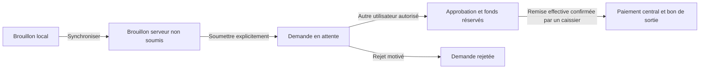

# Demandes de dépenses, approbations et paiements

## Préparer l’entreprise

Après mise à jour des sources, exécuter `pnpm db:generate`, `pnpm db:deploy`, puis `pnpm dev`. Les deux nouvelles migrations sont additives : elles conservent les écritures, reçus, soldes et demandes historiques. Ne pas remplacer ces migrations par `prisma db push`.

1. Avec un administrateur, ouvrir **Dépenses → Plafonds et règles**. Configurer séparément USD et CDF : plafonds par opération pour les demandes, approbations et paiements, et exigence de justificatif.
2. Affecter les utilisateurs à leurs agences et caisses dans **Utilisateurs**. Le directeur ou responsable financier peut approuver ; le caissier ou responsable financier peut payer. Un rôle et un plafond ne remplacent jamais les autres permissions et affectations.
3. Avec un caissier autorisé, ouvrir la session de caisse dans **Caisses**. Les fonds doivent provenir d’écritures centrales déjà comptabilisées.

Aucun plafond financier n’est inventé pour l’entreprise. Une devise sans politique configurée bloque les soumissions, approbations et paiements. Un plafond vide interdit l’action pour le rôle concerné. En cas de plusieurs rôles, le serveur utilise le plafond le plus élevé parmi les rôles actifs qui possèdent aussi la permission de l’action. L’administrateur conserve la configuration sans obtenir automatiquement le droit d’approuver ou de payer.

La réservation à l’approbation est obligatoire dans ce circuit. Les plafonds et l’exigence des justificatifs sont configurables ; la réservation et l’interdiction d’auto-approbation ne sont pas désactivables.

## Circuit

Dans **Préparation et soumission**, saisir montant exact, devise, bénéficiaire, motif, référence et justificatifs. **Enregistrer le brouillon** conserve seulement une préparation temporaire. **Synchroniser les brouillons** transmet une copie au serveur : aucune demande n’est soumise, aucun solde ne change. Utiliser ensuite **Soumettre la demande** sur le brouillon reçu par le serveur.

Une caisse doit être indiquée avant soumission. La préparation sans caisse reste disponible ; pour choisir ensuite une caisse différente, créer explicitement une copie. Les UUID et périmètres d’un brouillon déjà enregistré ne sont jamais réaffectés silencieusement. Une demande soumise est figée : si son montant, bénéficiaire ou motif doit changer, faire rejeter la demande et préparer une nouvelle demande.

Dans **Demandes et paiements**, l’approbateur consulte la demande et ses justificatifs. Il ne peut pas approuver sa propre demande, même avec plusieurs rôles. Le rejet exige un motif d’au moins trois caractères. L’approbation crée une réservation de fonds mais aucune écriture de sortie : solde comptable inchangé, montant disponible diminué.

Le caissier vérifie le bénéficiaire et la remise effective des fonds, coche l’attestation puis utilise **Confirmer le paiement**. Le serveur revalide session, rôle, plafonds actuels, agence, caisse active, session de caisse ouverte, approbation, réservation et fonds. Il consomme la réservation, comptabilise deux écritures équilibrées et crée le bon de sortie dans une seule transaction. Une erreur annule l’ensemble, y compris la numérotation du bon.

Le bon `BON-<entreprise>-<année>-<séquence>` est numéroté par entreprise et année à Kinshasa. Il conserve l’instantané du montant, bénéficiaire, motif, référence, demandeur, approbateur, caissier et dates. Il se consulte depuis la demande payée. L’impression utilise le rendu disponible du système ; un PDF synthétique Chromium ne valide pas une imprimante Windows/macOS ni une certification fiscale.

## Doublons, concurrence et perte de connexion

- Synchronisation : UUID stable de brouillon, auteur, entreprise, version et empreinte ; reprise avec la version serveur connue. Les brouillons restent privés à leur auteur.
- Soumission : une seule demande centrale par brouillon serveur, avec version attendue. Le serveur refuse toute modification du brouillon après sa soumission.
- Décision : une seule décision immuable par demande, avec auteur, motif et date ; une décision concurrente incompatible est refusée.
- Paiement : clé d’idempotence dérivée de l’identifiant de demande, indépendante de la session de connexion ; une seule opération et un seul bon par demande. Les comptes sont verrouillés dans un ordre stable, les transactions sont sérialisables et les contrôles de fonds sont aussi exécutés au commit PostgreSQL.

Après un résultat réseau incertain, **Actualiser les demandes** pour consulter l’état central. Si la demande est payée, ouvrir le bon existant. Un nouvel essai utilise la même demande ; ne pas créer une autre demande pour contourner une incertitude. Aucun bon n’est fabriqué par le client après une erreur.

Une modification de plafond s’applique aux actions suivantes, y compris au paiement d’une demande déjà approuvée. Une réservation seule ne débite pas le solde. Si la nouvelle limite bloque le paiement, un administrateur doit réexaminer la configuration ; le logiciel ne paie pas automatiquement lorsque les règles changent.

## Hors connexion et justificatifs

L’accès exige la session préalable autorisée, le déverrouillage natif et le respect des délais. Affichage **Non soumis / Hors connexion**, informations datées et non actualisées. La préparation reste possible ; soumission, décision et paiement sont interdits dans le courtier Rust comme dans l’interface. Le retour du réseau revalide session et permissions avant transmission des brouillons. Il ne soumet ni ne paie une demande automatiquement.

La conservation suit le mode confirmé par le courtier : SQLCipher sur les cibles qualifiées à l’étape 13-B, mémoire uniquement sur les autres. Un brouillon enregistré est conservé au plus sept jours dans le mode chiffré ; le bail d’accès hors connexion reste limité à quinze minutes. Après expiration ou déconnexion, une authentification serveur est exigée. Les données sont isolées par auteur et périmètre ; une révocation connue les invalide. Ni soumission, approbation ni paiement ne sont exécutés automatiquement. Voir [le bilan 13-B](etape-13b/BILAN.md).

Trois justificatifs maximum, PDF/PNG/JPEG, un Mio total de contenu décodé. Noms, base64 canonique, tailles et en-têtes sont vérifiés en Rust et côté serveur ; les copies centrales sont immuables et portent leur SHA-256. Les images sont consultables ; la prévisualisation des PDF et leur export sur disque restent indisponibles dans cette version. Utiliser une image lisible lorsqu’une vérification visuelle dans l’application est nécessaire.

Les données des demandes soumises sont accessibles uniquement dans le périmètre autorisé. Les anciennes demandes centrales sans source de brouillon restent consultables ; le nouveau desktop ne leur invente ni bénéficiaire ni bon de sortie et ne les convertit pas silencieusement. Les services financiers internes historiques restent présents pour leurs données existantes.

## API et contrôles

Routes sous `/api/v1/expenses` :

| Route                                      | Responsabilité                                                    |
| ------------------------------------------ | ----------------------------------------------------------------- |
| `GET /policies`, `PUT /policies/:currency` | Configuration versionnée, administrateur autorisé                 |
| `GET /drafts`, `GET /drafts/:id`           | Brouillons serveur de l’auteur, restauration native               |
| `POST /drafts/:id/submit`                  | Soumission explicite avec version attendue                        |
| `GET /requests`, `GET /requests/:id`       | Demandes du périmètre, filtres d’état/devise/caisse et pagination |
| `POST /requests/:id/decision`              | Approbation ou rejet motivé                                       |
| `POST /requests/:id/pay`                   | Attestation explicite et paiement atomique                        |
| `GET /vouchers/:id`                        | Bon de sortie central immuable                                    |
| `GET /requests/:id/evidence/:evidenceId`   | Justificatif de la demande autorisée                              |

Le frontend ne fournit jamais les identifiants des comptes, les contreparties comptables, l’approbateur ou le payeur à utiliser : le serveur les détermine à partir de la demande et de la session authentifiée. Les erreurs publiques exposent uniquement des codes de domaine autorisés, sans message SQL, montant privé ou secret de session.

Commandes : `pnpm check`, `pnpm test:db`, `pnpm test:session`, `pnpm test:auth:desktop`, `pnpm test:e2e`. Un sous-ensemble PostgreSQL peut être ciblé avec `pnpm test:db expenses.spec.ts`. Voir [validation.md](validation.md) pour les résultats réellement obtenus et les limites de qualification.
