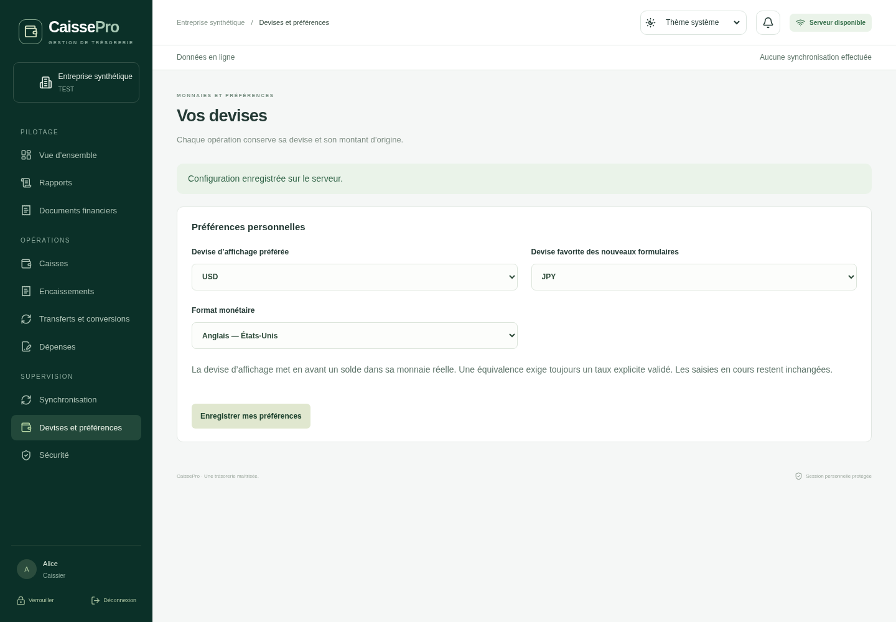

# Validation de l’étape 12

Validation dans le cloud Linux, PostgreSQL 17, Node 24 et Rust 1.90. Les données des scénarios sont synthétiques. Aucun installateur ni service public n’est publié.

| Contrôle                                      | Résultat                                                                                                                                                                                       |
| --------------------------------------------- | ---------------------------------------------------------------------------------------------------------------------------------------------------------------------------------------------- |
| ESLint, TypeScript, compilations API et React | Réussis via `pnpm check`                                                                                                                                                                       |
| Contrats partagés                             | 30 tests réussis, dont 5 nouveaux tests monétaires                                                                                                                                             |
| Interface React avec passerelle simulée       | 96 tests réussis, dont 4 nouveaux tests de préférences/devises                                                                                                                                 |
| HTTP de disponibilité avec double de base     | 4 tests réussis                                                                                                                                                                                |
| Lanceurs et permissions Node                  | 23 tests, dont 2 contrôles du catalogue ISO et de reproductibilité de la migration                                                                                                             |
| API/SQL réels                                 | 114 tests historiques et 17 nouveaux tests multidevises réussis                                                                                                                                |
| Courtier Rust                                 | 48 tests réussis, analyse Clippy sans avertissement et formatage conformes                                                                                                                     |
| Adaptateur SQLCipher Linux                    | 10 tests réussis, dont conservation des brouillons et accusés du schéma local 1 vers 2 ; Clippy et formatage conformes                                                                         |
| Migration de données existantes               | 39 tables historiques comparées en JSONB dans PostgreSQL : toutes les lignes conservées, y compris deux reçus CDF/USD, leurs brouillons sources, écritures et un PV de clôture ; RLS conservée |
| Échec transactionnel de migration             | Exception volontaire après les DDL : rollback vérifié, ancien enum toujours présent                                                                                                            |
| Sauvegarde/restauration réelle                | `pg_dump` custom puis `pg_restore` dans une seconde base jetable : nombres de lignes et empreintes des 43 tables identiques                                                                    |
| Migrations historiques                        | 15 empreintes SHA-256 vérifiées, aucun fichier historique remplacé                                                                                                                             |
| Parcours Chromium avec doubles IPC            | 14 tests réussis, dont préférences personnelles et brouillon JPY sans écriture                                                                                                                 |
| Fenêtre Tauri Linux réelle                    | Compilation `custom-protocol`, fenêtre 1280 × 900 visible et capture non vide ; pas de qualification macOS/Windows                                                                             |

Les nouveaux scénarios PostgreSQL couvrent une, deux et plusieurs devises actives ; les unités JPY/KWD/CLF ; les grands décimaux au-delà de `Number.MAX_SAFE_INTEGER` ; les taux explicites et les arrondis de destination à 0/3/4 décimales ; les réservations, doublons et dépenses concurrentes ; les préférences individuelles sans conversion d’opération ; les permissions et sessions révoquées ; la désactivation concurrente sans suppression de la dernière devise ; les contre-écritures d’une devise devenue inactive ; les clôtures à quatre devises ; les PDF et Excel ; un reçu et un bon de sortie KWD à trois décimales ; un brouillon JPY synchronisé sans écriture ; et l’ajout d’un code au catalogue sans changement de contrat ou de schéma.

Le test de migration crée deux bases `caissepro_test_<aléatoire>` et `caissepro_test_<aléatoire>_restore`, puis supprime uniquement celles qu’il a créées. Le test comptable ordinaire utilise sa propre base jetable. Ils ne réinitialisent pas la démonstration existante.

Commandes reproductibles :

```bash
pnpm check
pnpm test:db
pnpm test:currency:upgrade
pnpm test:session
pnpm test:local
pnpm format:check
pnpm db:validate
sha256sum -c docs/audit-etape-11/migrations.sha256
PLAYWRIGHT_CHROMIUM_EXECUTABLE_PATH=/usr/bin/chromium pnpm test:e2e
```

La commande Playwright utilise des doubles IPC explicitement déclarés ; les validations financières réelles sont celles de PostgreSQL. L’adaptateur chiffré reste bloqué en application. Les tests de mot de passe ne stockent ni n’affichent les secrets.

Le catalogue initial est daté de 2024 et ne constitue pas une vérification en ligne de la liste ISO courante. Le statut de disponibilité BCC est non vérifié ; aucun taux BCC n’est inventé. L’impression sur imprimante, la persistance sécurisée native Windows/macOS et les installateurs ne sont pas attestés par ces contrôles.

## Aperçu de présentation



Cette capture provient du test Chromium avec double IPC ; elle montre la présentation, et ne prouve pas une connexion à une entreprise réelle. Les écritures et les permissions sont vérifiées séparément sur PostgreSQL.
