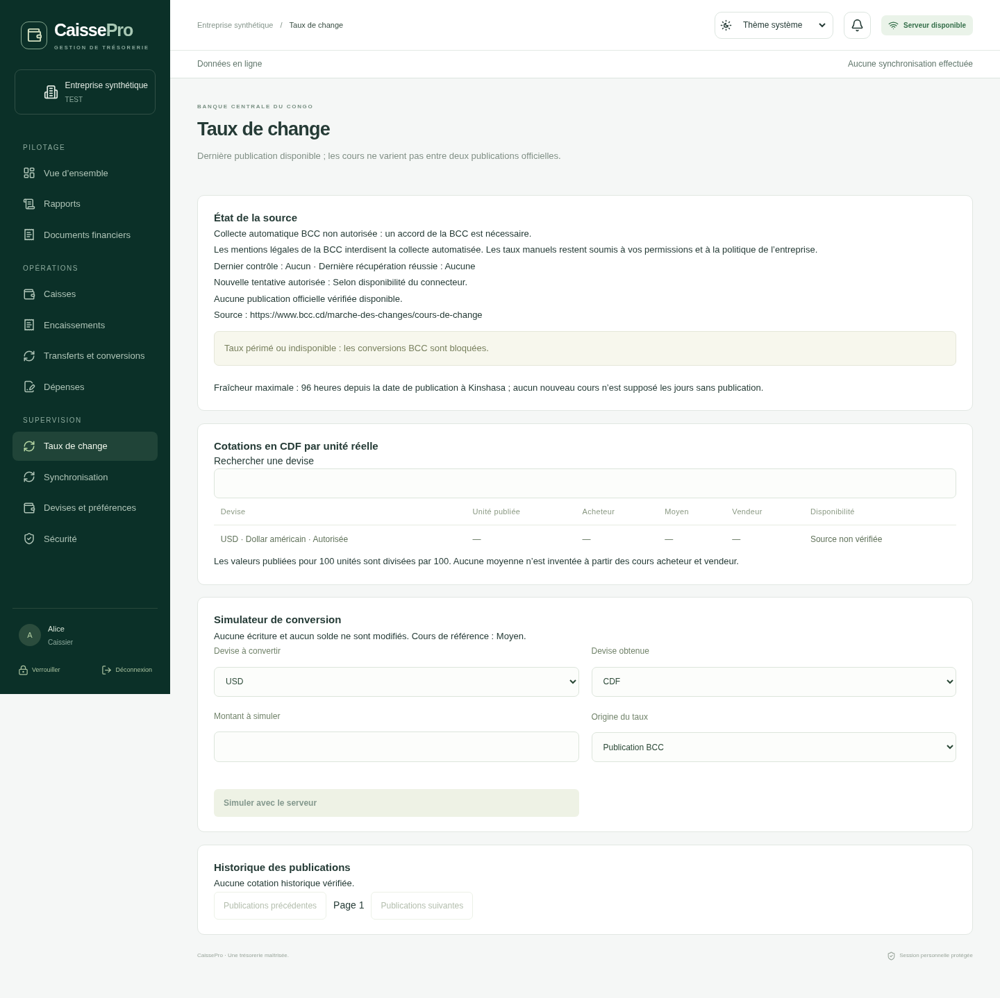

# Étape 13 — livrable avec repli BCC explicite

Bilan du 12 novembre 2026. Branche `feat/etape-13-taux-bcc`, base Git `f87199d94cb80d19c4992f376893b316b2a9a083` (étape 12).

**Le module de change, les taux manuels sécurisés et l’architecture pour un flux BCC autorisé sont livrés. La collecte automatique des pages BCC reste désactivée : les mentions légales consultées le 12 novembre interdisent cette utilisation.**

Cela correspond au repli prévu par la demande initiale : « Si l’accès automatique officiel n’est pas techniquement ou légalement possible, livrer une architecture prête à recevoir un fournisseur autorisé et documenter précisément le blocage. » L’aval pour poursuivre les autres étapes concerne ce périmètre livré et testé. Il ne signifie pas que les cours BCC sont récupérés automatiquement. Aucun taux inventé ou tiers n’est présenté comme un cours officiel.

## Source réelle et restriction vérifiées

Les quatre pages suivantes ont répondu HTTP 200 avec vérification TLS activée :

- [Cours du jour](https://www.bcc.cd/marche-des-changes/cours-de-change).
- [Convertisseur](https://www.bcc.cd/marche-des-changes/convertisseur).
- [Série historique](https://www.bcc.cd/statistiques/secteur-exterieur/cours-de-change).
- [Mentions légales](https://www.bcc.cd/mentions-legales).

La configuration réseau publiée autorise désormais `www.bcc.cd` et `bcc.cd`. Le refus 403 du proxy observé le 11 novembre est résolu. [Preuve HTTP](preuves/acces-bcc-2026-11-12.txt).

La page quotidienne consultée présente les cours acheteur, moyen et vendeur de 21 devises, datés du 12 novembre 2026. La série statistique décrit des cotations pour 100 unités, notamment JPY, XAF et plusieurs monnaies régionales ; ses dernières observations affichées sont datées du 11 novembre. Ces références temporelles ne doivent pas être mélangées. Les pages contiennent du HTML et des données de rendu intégrées ; aucune API publique documentée et autorisée n’a été identifiée sur les pages examinées. Cela ne démontre pas l’absence d’une offre de données distincte.

Les mentions légales précisent : « la collecte automatisée (crawling ou scraping), l’archivage systématique et la rediffusion automatisée des contenus du site au moyen d’applications ou de scripts sont interdits. » Elles restreignent aussi l’usage commercial. Le fichier robots ne supprime pas ces conditions de réutilisation. [Date, empreinte et court extrait vérifiés](preuves/conditions-bcc-2026-11-12.json).

Ces consultations servent à l’étude de faisabilité. Aucun collecteur récurrent du site n’a été lancé, aucune série réelle n’a été importée dans une entreprise et aucun parseur du HTML interne n’a été activé. Le blocage restant concerne l’autorisation de collecte, pas le réseau. Aucun contact n’a été envoyé à la BCC.

## État fonctionnel

| Élément                                             | Résultat                                                                                                                   |
| --------------------------------------------------- | -------------------------------------------------------------------------------------------------------------------------- |
| Catalogue et préférences de l’étape 12              | Préservés ; CDF/USD et autres précisions testés                                                                            |
| Interface de fournisseur                            | Indépendante et remplaçable ; transport borné et coordination serveur prêts                                                |
| Fournisseur livré                                   | `BccAuthorizationRequiredConnector`, aucune requête externe, motif `BCC_AUTHORIZATION_REQUIRED`                            |
| Collecte réelle automatique                         | Désactivée jusqu’à un accord ou une offre de données adaptée                                                               |
| Stockage et historique                              | Publications, cotations et propositions immuables ; dates, unités, origine et empreintes conservées                        |
| Calculs                                             | Décimaux exacts, unités 1/100, cours distincts, croisement d’une seule publication et d’un seul type                       |
| Politique d’entreprise                              | Type de cours, âge maximal, validité de proposition et autorisation manuelle                                               |
| Actualisation                                       | Ordonnanceur, bail, déduplication et temporisation testés avec fournisseur synthétique ; dormant avec le fournisseur livré |
| Conversion manuelle                                 | Source, date, justification, permission, remise, réception et comptabilisation testées                                     |
| Preuve de taux                                      | Fixée à la remise, conservée à la réception et reliée à l’opération immuable                                               |
| Desktop                                             | Écran Taux de change, historique, simulation, politique et restriction explicite                                           |
| Hors connexion                                      | Préparation uniquement, aucune opération financière définitive                                                             |
| Qualification native Windows/macOS et installateurs | Non exécutés, hors périmètre                                                                                               |

## Règles conservées

Les taux sont récupérés exclusivement côté serveur pour un fournisseur habilité, avec un contrat vérifié dans le code et une approbation de même URL/version dans PostgreSQL. Le fournisseur livré reste fermé même si un ancien agrément existe en base. Ni un bouton, ni une variable d’environnement, ni un simple libellé de source manuelle ne permettent de le présenter comme une collecte officielle autorisée.

Le coordinateur vérifie l’éligibilité chaque minute et espace les appels externes d’au moins une heure ; ce sont des limites de fonctionnement CaissePro, pas une fréquence officielle attribuée à la BCC. Il utilise un bail PostgreSQL, une déduplication par empreinte/version et un repli temporisé de 1, 2, 4 puis au maximum 6 heures. Pour un fournisseur autorisé, une panne conserve les anciennes publications sans inventer de nouveau cours ; leur utilisation reste soumise à la fraîcheur maximale et à un état explicite.

Les cours sont normalisés en CDF par unité réelle ; une valeur pour 100 unités est divisée exactement par 100. Aucune moyenne n’est déduite des cours acheteur et vendeur. Le croisement utilise une publication unique et un type unique ; CDF = 1 est l’identité de base. Le taux applicable est arrondi HALF_UP à 12 décimales puis le montant à la précision de destination. Les montants circulent en chaînes décimales, sans additionner des monnaies différentes.

La politique fixe le type de cours (MEAN par défaut), l’âge maximal de 1 à 168 heures (96 par défaut) et la validité d’une proposition de 1 à 30 minutes (15 par défaut). L’âge commence prudemment à minuit de la date de publication à Kinshasa ; aucune heure officielle n’est inventée. Les jours sans publication ne prolongent pas la limite.

Un taux manuel exige `fx:manual`, la politique d’entreprise, une source, une justification et une date effective. La simulation ne comptabilise rien. Le serveur revalide auteur, entreprise, devises, montant, politique, durée et publication à la transmission puis à la remise. La remise fixe la preuve ; un autre utilisateur confirme la réception et déclenche la comptabilisation atomique. Une publication ultérieure ne réévalue pas des fonds déjà remis ni une écriture passée. Les anciens clients conservent un circuit manuel historique explicite ; un texte saisi ne peut pas créer une origine BCC vérifiée.

Les transactions restent SERIALIZABLE. Les reprises de sérialisation sont bornées à neuf essais, avec délai exponentiel plafonné et variation afin d’éviter des tentatives synchronisées. Un refus métier tel que des fonds insuffisants n’est pas rejoué. Les tests conservent six transmissions identiques sans mouvement financier ni second brouillon.

## Migration et données existantes

La migration `20261111000200_bcc_exchange` ajoute sept tables et des preuves nullables, sans remplacer les 16 migrations antérieures. L’immuabilité et RLS sont maintenues. Les validations du 11 novembre ont vérifié 43 tables historiques, le rollback DDL et une sauvegarde/restauration de 50 tables identiques ; la migration et les contrôles financiers sont de nouveau vérifiés le 12 novembre, avec une restauration de 50 tables identiques.

Aucune base existante n’est réinitialisée ou migrée pendant les tests : seules leurs bases aléatoires sont créées puis supprimées. Les corrections de rôles et de navigation de l’audit ne sont pas entreprises. La capacité `fx:manual` appartenait déjà au chantier repris ; elle préserve les rôles disposant de `fx:post`, sans élargir les droits de l’Administrateur ou du Caissier. La persistance chiffrée locale reste bloquée ; les brouillons locaux suivent toujours les limites de mémoire de session.

Avant déploiement : sauvegarde cohérente, restauration de contrôle, puis migration versionnée avec le compte habilité avant démarrage du nouveau code. Un retour arrière doit préserver les nouvelles tables et opérations ; ne pas restaurer une sauvegarde en effaçant les mouvements intervenus depuis. La compatibilité d’un ancien code avec des données futures BCC doit être qualifiée séparément.

## Suite et portée de l’aval

Les autres travaux peuvent continuer avec le mode manuel autorisé et la collecte BCC explicitement désactivée. L’activation automatique nécessite encore une autorisation ou un flux BCC adapté, un contrat documenté, un adaptateur et un test réel de réception/actualisation. L’allowlist et l’approbation opérateur devront correspondre à ce contrat ; aucun endpoint n’est inventé.

Une [demande prête à compléter](DEMANDE-AUTORISATION.md) est fournie ; aucun courriel n’a été envoyé. Consulter les [résultats des tests](VALIDATION.md), la [liste des fichiers](FICHIERS.md) et l’[état historique du 11 novembre](HISTORIQUE-2026-11-11.md). Aucun passage automatique à l’étape 14, aucune publication cloud et aucun installateur ne sont effectués.

