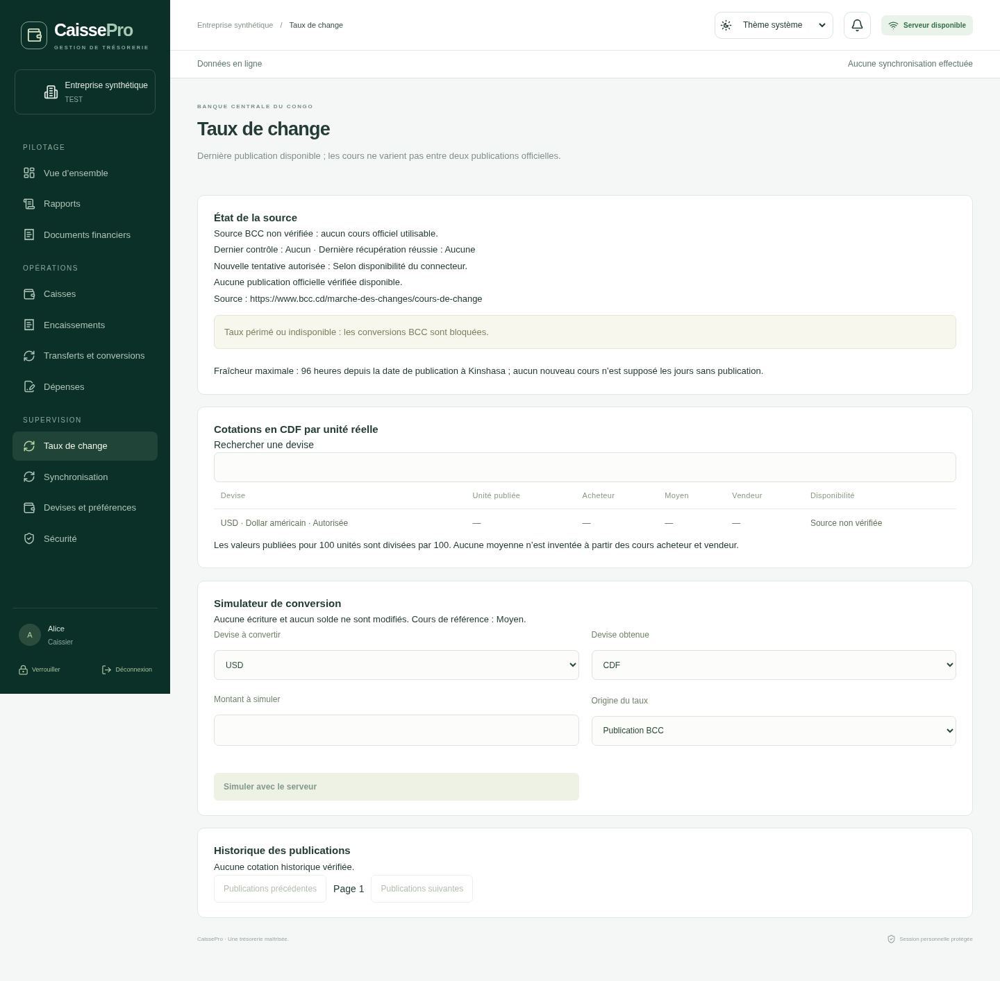

> État historique du 11 novembre 2026, remplacé par BILAN.md. Le blocage réseau décrit ci-dessous est résolu ; une restriction de collecte a été identifiée le 12 novembre.

# Étape 13 — bilan de reprise BCC

Situation vérifiée le 11 novembre 2026. Branche `feat/etape-13-taux-bcc`, base Git `f87199d94cb80d19c4992f376893b316b2a9a083` (étape 12).

**Le socle BCC, les propositions de taux, leur rattachement aux conversions et l’écran desktop sont implémentés et testés. L’intégration automatique avec les publications réelles de la BCC ne peut pas être déclarée achevée : le domaine officiel est bloqué par la politique réseau du cloud et aucun format ni droit de récupération n’a pu être vérifié.**

Le connecteur livré par défaut reste fermé (`UnverifiedBccConnector`). Aucun taux synthétique n’est installé dans la démonstration ou présenté comme un taux officiel. La solution correspond à l’architecture prête pour un fournisseur autorisé prévue par le livrable initial ; elle ne vaut pas qualification de la source réelle.

## État au début de la reprise et résultat

| Élément                                                | État initial                                                | État après reprise                                                                                                     |
| ------------------------------------------------------ | ----------------------------------------------------------- | ---------------------------------------------------------------------------------------------------------------------- |
| Schéma Prisma et migration BCC                         | Présents, partiellement éprouvés                            | Migration additive testée depuis l’étape 12, rollback DDL et restauration vérifiés                                     |
| Normalisation des unités et cours croisés              | Code présent sans couverture dédiée                         | Tests déterministes : unités 1/100, cours distincts, dates, taux invalides, EUR/USD via CDF                            |
| Connecteur au format réel de la BCC                    | Absent, source non vérifiée                                 | Toujours absent volontairement ; transport HTTPS et contrat remplaçable prêts, activation fermée                       |
| API publique officielle BCC et modalités d’utilisation | Non vérifiées                                               | Non vérifiables avec l’accès réseau actuel ; aucune API supposée ou inventée                                           |
| Coordinateur d’actualisation                           | Implémentation initiale, non validée                        | Testé avec fournisseur synthétique : bail serveur, concurrence, déduplication, reprise et conservation de l’historique |
| Déclenchement planifié                                 | Présent, désactivé pour le connecteur non vérifié           | Minuterie testée ; demeure dormant avec le connecteur livré                                                            |
| Propositions de taux BCC/manuels                       | API partielle ; réponse incompatible avec son schéma strict | Réponse corrigée, contrôle de politique, fraîcheur, propriétaire et audit testés                                       |
| Utilisation dans un transfert/FX                       | Champs backend initiaux, liaison desktop absente            | Proposition reliée au brouillon, transmise par Rust, revalidée avant remise et preuve immuable conservée               |
| Historique des cotations                               | Publications seules                                         | Publications et cours bruts/normalisés consultables, sans remplacement historique                                      |
| Écran Taux de change                                   | Absent                                                      | Créé : statut, cours, dates, historique, simulation, politique et actualisation autorisée                              |
| Tests BCC                                              | Absents                                                     | Tests unitaires, PostgreSQL, React, Rust et Chromium ajoutés ; régressions CDF/USD rejouées                            |
| Qualification de l’application native Windows/macOS    | Non vérifiée                                                | Non entreprise ; aucun installateur créé                                                                               |

## Source officielle : constat précis

Les trois adresses fournies dans la demande restent les seules destinations autorisées par le transport du module :

- <https://www.bcc.cd/marche-des-changes/cours-de-change>
- <https://www.bcc.cd/marche-des-changes/convertisseur>
- <https://www.bcc.cd/statistiques/secteur-exterieur/cours-de-change>

La première URL a été essayée avec le proxy et la vérification TLS de l’environnement. Le résultat est **`CONNECT tunnel failed, response 403`**, émis par le proxy cloud avant contact avec le site. [En-têtes conservés](preuves/acces-bcc-2026-11-11.txt). La politique appliquée ne comprend pas `www.bcc.cd` ; son ajout et celui de `bcc.cd` figurent dans le brouillon de configuration, mais ce brouillon n’est pas appliqué. Aucune publication cloud n’a été effectuée.

Ce constat ne démontre ni une panne de la BCC, ni l’absence d’API publique, ni une interdiction juridique de récupération. Le contenu des trois pages, les éventuels fichiers/API documentés, les dates et heures réellement publiées, les séries pour 100 unités et les conditions d’utilisation demeurent à examiner. Les formats JSON utilisés dans les tests sont **notre contrat interne synthétique**, pas une description d’une API BCC.

La suite nécessaire est : autoriser l’accès officiel dans cet environnement, examiner les pages et leurs sources structurées documentées, vérifier les modalités d’utilisation, conserver des exemples officiels datés avec preuve de leur unité, puis implémenter le petit adaptateur correspondant. Le transport refuse les redirections, les destinations arbitraires, les réponses de plus de 2 Mo et les requêtes dépassant 10 secondes. Il conserve TLS et les paramètres proxy du serveur. Aucune protection du site ne doit être contournée.

## Fonctionnement implémenté

### Actualisation et repli

Les récupérations sont exclusivement serveur. PostgreSQL conserve publications, cotations et événements. Le coordinateur exige à la fois un connecteur dont le contrat est vérifié dans le code et une approbation de cette même URL/version dans `BccSourceApproval`. Il n’existe pas de route HTTP permettant de transformer une source non vérifiée en source officielle.

La minuterie vérifie toutes les minutes si une récupération est autorisée ; les appels externes sont espacés d’au moins une heure pour toute l’installation. Ce sont des limites de fonctionnement choisies pour CaissePro, **pas une fréquence de publication attribuée à la BCC**. Un bail PostgreSQL de 30 secondes protège les instances concurrentes. Une panne entraîne une temporisation de 1, 2, 4 puis au maximum 6 heures. `BCC_SCHEDULER_ENABLED=0` désactive la minuterie ; l’actualisation manuelle reste soumise aux permissions et au même délai serveur.

Un document déjà ingéré est dédupliqué par empreinte/version. La date de récupération initiale de la publication reste immuable ; les contrôles suivants ont leurs propres événements. Une panne ou une absence de nouvelle publication ne supprime pas les anciennes cotations et n’invente aucun nouveau cours. Un cache vérifié encore assez récent peut servir avec l’état « Source indisponible » affiché ; au-delà de la fraîcheur autorisée, la conversion BCC est bloquée. Les jours sans publication et week-ends n’allongent pas silencieusement cette limite.

### Calculs, sélection du cours et fraîcheur

- Cours bruts, unité et preuve de l’unité sont conservés. La valeur normalisée est en CDF pour une unité réelle de devise : cours brut divisé par 1 ou 100.
- Acheteur, moyen et vendeur restent distincts. Une moyenne absente n’est pas calculée à partir des deux autres cours.
- Pour deux monnaies cotées en CDF, le taux de destination par unité source est `CDF/source ÷ CDF/destination`, avec une seule publication et un seul type de cours. CDF = 1 est l’identité de la monnaie de base, pas une cotation inventée.
- Politique par entreprise : type de cours (`MEAN` par défaut), fraîcheur maximale de 1 à 168 heures (96 par défaut) et validité d’une proposition de 1 à 30 minutes (15 par défaut).
- Par prudence, la fraîcheur commence à minuit de la date publiée à Kinshasa. Un horodatage officiel, s’il est disponible, reste conservé séparément ; aucun horaire de publication n’est inventé.
- Les valeurs utilisent des décimaux exacts. Le taux croisé applicable est arrondi HALF_UP à 12 décimales ; le montant est ensuite calculé avec ce taux explicite et arrondi HALF_UP à la précision de destination. Les deux niveaux d’arrondi sont documentés dans l’instantané.
- Une préférence d’affichage ne change ni les unités ni les montants de l’opération ; les soldes restent séparés par devise et issus du journal.

### Taux manuel, validation et historique immuable

La simulation ne poste aucune écriture. Le taux appliqué est distinct d’un éventuel taux BCC de référence. Un taux manuel exige la politique d’entreprise, la permission `fx:manual`, une source, une justification et une date effective. Aucun fournisseur alternatif n’est présenté comme BCC.

La capacité `fx:manual` faisait déjà partie du chantier repris. La migration la rattache aux rôles existants possédant `fx:post`, pour préserver leurs conversions manuelles. Elle n’élargit pas les droits financiers de l’Administrateur ou du Caissier. Les corrections de permissions demandées par l’audit précédent ne sont pas commencées.

Le desktop prépare une proposition serveur et en conserve l’identifiant dans son brouillon. Hors connexion, il ne crée ni n’applique une proposition officielle ; un brouillon doit faire l’objet d’une vérification explicite après reconnexion. Le serveur vérifie propriétaire, entreprise, monnaies, montant, politique, expiration et dernière publication à la transmission puis à la remise.

La remise explicite fixe la preuve : publication, source, empreinte, cours bruts et normalisés, type de cours, taux de référence/appliqué, arrondi, montants, responsable, justification et dates. La réception par un autre utilisateur conserve cette preuve dans le taux référencé par l’opération comptable. Une nouvelle publication entre remise et réception ne modifie pas les fonds déjà remis ; les permissions et sessions de réception restent vérifiées. Le détail du transfert et le bordereau exposent la provenance.

Les clients historiques sans identifiant de proposition conservent un circuit manuel explicitement signalé comme tel, soumis à la politique et à `fx:manual` ; leur déclaration de source sert de justification historique. Ils ne peuvent pas produire une origine BCC vérifiée par simple texte. Les opérations existantes ne sont pas réécrites ; les nouveaux champs de preuve restent nuls pour les anciennes lignes. Un brouillon serveur expiré reste consultable mais ne peut pas être remis ; sa reprise doit préserver la distinction avec une opération dont le résultat était incertain. Aucune confirmation financière n’est rejouée automatiquement.

Les brouillons locaux continuent à suivre la limite de mémoire de session existante. Leur conservation durable, la navigation générale et les installateurs ne sont pas corrigés dans cette intervention.

## Migration, sauvegarde et retour arrière

La nouvelle migration est `20261111000200_bcc_exchange`. Elle ajoute sept tables (`BccSourceApproval`, `BccRefreshState`, `BccPublication`, `BccQuotation`, `BccRefreshEvent`, `ExchangeRatePolicy`, `RateQuote`), des références et preuves nullables aux transferts/taux, les protections SQL et le droit de taux manuel. Les 16 migrations précédentes ne sont pas remplacées. Les publications et propositions sont immuables ; les cotations doivent être insérées dans la même transaction que leur publication, et aucune cotation tardive ne peut être ajoutée à une publication scellée.

Le test `pnpm test:bcc:upgrade` applique d’abord les 16 migrations, prépare deux reçus CDF/USD, leurs écritures, un PV, un ancien taux et un brouillon de conversion, mémorise les anciennes valeurs en JSONB PostgreSQL puis applique la migration 17. Les 43 tables historiques sont comparées en ignorant uniquement les colonnes additives et les ajouts explicites de permission. RLS est préservée. Un échec volontaire après les DDL vérifie le rollback complet. Un `pg_dump` est restauré dans une seconde base jetable : les 50 tables sont identiques.

Aucune base existante n’a été migrée pendant cette reprise. Avant déploiement : sauvegarde PostgreSQL cohérente hors du volume actif, restauration de contrôle, fenêtre de maintenance adaptée puis `pnpm db:deploy` avec le compte de migration disposant des droits nécessaires aux rôles SQL. Ne pas utiliser `prisma db push`, supprimer un volume ou réinitialiser une base. La disponibilité de cette version exige les nouvelles tables ; la migration doit précéder son démarrage.

En cas de retour arrière, garder les tables et les historiques ajoutés et revenir à un code compatible, après vérification des nouveaux contrôles SQL. Ne pas retirer aveuglément la migration ni restaurer une ancienne sauvegarde au prix d’effacer des opérations enregistrées depuis. Avant activation d’une source réelle, un retour à l’ancien code doit être qualifié sur les nouvelles données BCC ; le seul rollback DDL testé ne prouve pas cette compatibilité applicative future.

## Fichiers et preuves

Les fichiers principaux sont le schéma et la migration Prisma ; `apps/api/src/exchange/*` ; `packages/shared/src/exchange.ts` et les contrats de transfert/brouillon ; le courtier Rust ; `apps/desktop/src/exchange/*`, le gateway et le formulaire de transfert ; les tests et le script de migration. La liste exhaustive figure dans [FICHIERS.md](FICHIERS.md).

Les résultats sont détaillés dans [VALIDATION.md](VALIDATION.md). L’image ci-dessous provient de Chromium avec un double IPC et une entreprise synthétique : elle prouve l’affichage de l’état fermé, pas une connexion réelle à la BCC.

**Fin d’étape non confirmée pour l’intégration réelle.** Restent obligatoires la vérification de la source, du format, des unités et modalités de récupération, l’adaptateur officiel, puis une réception réelle et une actualisation observée avec ce fournisseur. Aucune étape 14 ni fabrication d’installateurs n’est entreprise.
